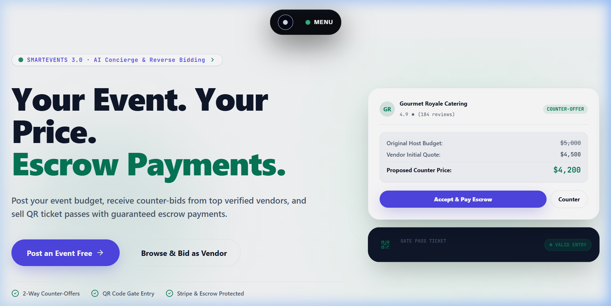
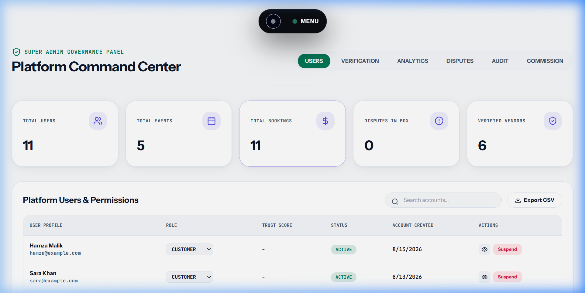
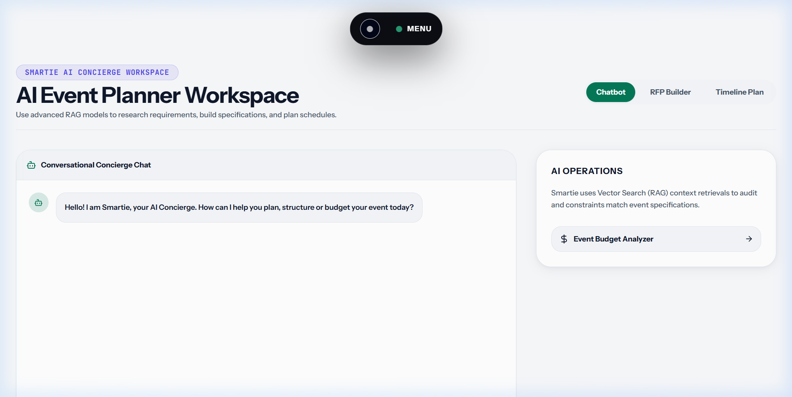
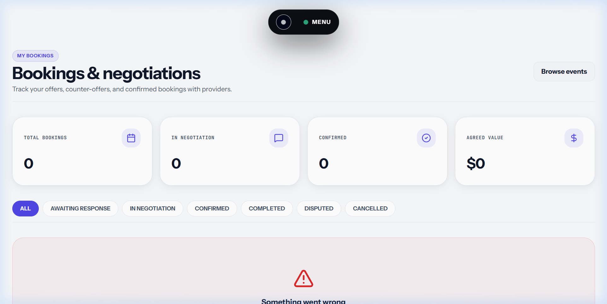

# SmartEvents

**An event services marketplace with real-time, two-sided price negotiation.**

Most event platforms post a fixed price and leave you to take it or leave it. But event services are *inherently* negotiable — they vary by date, guest count, season, and how much idle capacity a provider has this month. That negotiation already happens; it just happens off-platform, over WhatsApp, with no record.

SmartEvents brings it on-platform and makes it **live, structured, and auditable**.

> **Final Year Project (FYP-2)** · BS Software Engineering
> MongoDB · Express · React 19 · Node.js · Socket.IO · LLM integration

---

## Contents

- [What it does](#what-it-does)
- [Screens](#screens)
- [Architecture](#architecture)
- [Feature overview](#feature-overview)
- [Quick start](#quick-start)
- [Environment variables](#environment-variables)
- [Testing](#testing)
- [API documentation](#api-documentation)
- [Deployment](#deployment)
- [Project structure](#project-structure)
- [Design decisions worth defending](#design-decisions-worth-defending)
- [Known limitations](#known-limitations)
- [Further documentation](#further-documentation)

---

## What it does

Three roles meet on the platform:

| Role | What they do |
|---|---|
| **Customer** | Browses events and providers, makes an offer at *their* price, negotiates, books, attends with a QR pass, leaves a review |
| **Provider** | Lists service packages, receives offers, counters or accepts, manages availability, tracks revenue |
| **Admin / SuperAdmin** | Moderates users, rules on disputes, monitors fraud risk and platform health |

### The negotiation engine

```
CUSTOMER                        SERVER                        PROVIDER
   │                              │                              │
   │─ offer $4,000 ──────────────▶│                              │
   │                              │─ check blocked dates         │
   │                              │─ append to history[0]        │
   │                              │─ notify ────────────────────▶│ 🔔 live
   │                              │                              │
   │         ┌──── both open /negotiate/:id ────┐                │
   │         │  socket verifies both are party  │                │
   │         └──────────────────────────────────┘                │
   │                              │◀──── counter $4,500 ─────────│
   │◀─ 'offer-countered' ─────────│      lastPrice = 4000        │
   │  🔔 toast + live update       │      history[1] appended     │
   │                              │                              │
   │─ accept ────────────────────▶│─ status: confirmed           │
   │                              │─ notify both parties ───────▶│
```

Every step is timestamped and appended to an **immutable negotiation history**. Nothing is overwritten, so the full thread is always auditable — which matters when a dispute is raised later.

Simultaneous counters from both parties are handled with **optimistic concurrency** (Mongoose `versionKey`): the second write fails cleanly with a "please refresh" message rather than silently clobbering the first.

---

## Screens

### Home — public landing page


### Dashboard — SuperAdmin after sign-in


### AI Concierge — Smartie chat


### Bookings — negotiation list


---

## Architecture

```
┌────────────────────────────────────────────────────────────────┐
│  CLIENT — React 19 + Vite                                      │
│  Redux Toolkit · React Router v7 · Tailwind (semantic tokens)  │
│  ┌────────────┐  ┌──────────────┐  ┌────────────────────────┐ │
│  │ Axios      │  │ WebSocket    │  │ ThemeContext           │ │
│  │ + JWT      │  │ Context      │  │ (light/dark tokens)    │ │
│  │ + refresh  │  │ (authed)     │  │                        │ │
│  └─────┬──────┘  └──────┬───────┘  └────────────────────────┘ │
└────────┼────────────────┼──────────────────────────────────────┘
         │ REST /api/v1   │ WebSocket (JWT handshake)
┌────────▼────────────────▼──────────────────────────────────────┐
│  SERVER — Express 5                                            │
│  helmet · cors · rate-limit · mongo-operator sanitisation      │
│  ┌──────────────────────────────────────────────────────────┐  │
│  │ ROUTES → MIDDLEWARE → CONTROLLERS → SERVICES → MODELS    │  │
│  │   verifyToken · authorize(roles) · validate(zodSchema)   │  │
│  └──────────────────────────────────────────────────────────┘  │
└──────┬──────────────────┬─────────────────────────────────────┘
       │                  │
┌──────▼─────┐   ┌────────▼────────┐
│  MongoDB   │   │  Groq           │
│  Atlas     │   │  llama-3.1-8b   │
└────────────┘   └─────────────────┘
```

**Layering:** `route → middleware → controller → service → model`. Controllers handle HTTP shape only; business logic lives in `services/`.

`app.js` builds the Express app and `index.js` starts it — so the test suite can mount the app with supertest without opening a port.

---

## Feature overview

### Negotiation & bookings
- Offer → counter → accept/reject, live over WebSockets
- Immutable, timestamped negotiation history with price deltas
- Turn-taking indicator; optimistic UI with rollback on failure
- Optimistic concurrency guards against simultaneous counters
- Availability calendar — blocked dates reject bookings at creation
- Dispute escalation, ruled on by an administrator

### Marketplace
- Event listings with filtering, search, price range, sort and pagination
- Vendor marketplace with portfolios and service packages
- Reviews gated behind a confirmed booking, one per user per event
- Favourites / wishlist

### Trust & governance
- **Trust score** — a weighted ratio of completion rate, review ratings, disputes and no-shows (not a running tally, so it actually discriminates)
- **Fraud risk engine** — cancellation velocity, dispute frequency, no-shows, account flags
- **Audit ledger** — every ban, role change, verification and dispute ruling recorded with actor, IP and severity
- **SuperAdmin console** — analytics, fraud, disputes, providers, audit log and live health, in one tabbed workspace

### AI concierge ("Smartie")
- Answers questions using the caller's **live business data**, assembled fresh per request
- Generates structured RFPs from plain-English descriptions
- Builds planning timelines and analyses budgets
- **Proposes actions** — can offer to create a service package, which the user confirms before anything is written
- Falls back to static content when the model is unavailable, so a demo never shows an empty state

### Ticketing
- Digital passes with QR payloads
- Gate scanner with duplicate-entry detection

---

## Quick start

**Prerequisites:** Node.js 18+, MongoDB running locally or an Atlas URI.

```bash
# 1. Install everything
npm run install:all

# 2. Configure the server
cd server
cp .env.example .env
node -e "console.log(require('crypto').randomBytes(48).toString('hex'))"   # paste as JWT_SECRET
cd ..

# 3. Seed demo data
npm run seed --prefix server

# 4. Run both apps
npm run dev
```

- Client → http://localhost:5173
- API → http://localhost:5000/api/v1
- API docs → http://localhost:5000/api-docs

### Demo accounts

All seeded accounts use the password `password123`.

| Role | Email |
|---|---|
| SuperAdmin | `superadmin@smartevents.com` |
| Admin | `admin@smartevents.com` |
| Provider | `umar_provider@example.com` |
| Customer | `ali@example.com` |

The login page has one-click buttons for these — they sign in through the real API, not a shortcut.

---

## Environment variables

Server config is **validated at boot** (`server/config/env.js`). A missing or malformed value stops the process with a readable message rather than failing later in a confusing way.

| Variable | Required | Purpose |
|---|:---:|---|
| `MONGODB_URI` | ✅ | Database connection string |
| `JWT_SECRET` | ✅ | Token signing key, minimum 16 characters |
| `NODE_ENV` | | `development` \| `test` \| `production` |
| `PORT` | | API port (default 5000) |
| `ALLOWED_ORIGINS` | | Comma-separated CORS whitelist |
| `CLIENT_URL` | | Base URL used in password-reset links |
| `GROQ_API_KEY` | | Smartie chat, RFPs, timelines, budgets |
| `SMTP_*` | | Transactional email; logs to console if unset |

Client config lives in `client/.env` (see `client/.env.example`): `VITE_API_URL`, `VITE_SOCKET_URL`.

---

## Testing

```bash
npm test --prefix server              # unit + integration
npm run test:coverage --prefix server # with coverage report
npm run test:e2e --prefix server      # end-to-end against a running server
```

Tests run against an **in-memory MongoDB** (`mongodb-memory-server`), so the suite needs no external service and is safe to run in CI. Each test starts from a clean database.

```
server/tests/
├── setup.js                      in-memory Mongo lifecycle
├── helpers.js                    user/event factories, auth headers
├── unit/
│   ├── trustScore.test.js        scoring formula, per branch
│   ├── fraudRisk.test.js         classification thresholds and signals
│   └── validation.test.js        every Zod schema + operator sanitisation
└── integration/
    ├── auth.test.js              registration, login, tokens, reset
    ├── negotiation.test.js       the full offer → counter → settle lifecycle
    └── rbac.test.js              each role against each protected route
```

The negotiation engine carries the deepest coverage, since it is the project's core contribution.

---

## API documentation

Interactive OpenAPI 3.0 docs at **`/api-docs`** when the server is running — 34 documented endpoints, with request/response schemas and a working "Try it out" against your local instance.

Raw spec: `/api-docs.json`.

**Status code convention:**
- `401` — credential missing or expired; the client refresh flow should fire
- `403` — credential valid, role insufficient
- `409` — conflict (already settled, date blocked, concurrent modification)

---

## Deployment

**Important:** the negotiation feature depends on persistent WebSocket connections. Vercel's Node runtime is serverless and cannot hold them open, so deploy the API somewhere that supports long-lived connections.

| Component | Recommended |
|---|---|
| API | Render, Railway or Fly.io (all have free tiers) |
| Client | Vercel or Netlify, with `VITE_API_URL` set |
| Database | MongoDB Atlas free tier, with an IP allowlist |

```bash
npm run build --prefix client   # → client/dist
npm start --prefix server       # production server
```

---

## Project structure

```
SmartEvents/
├── client/
│   └── src/
│       ├── api/axios.js              JWT injection + refresh-token retry queue
│       ├── components/
│       │   ├── ui/                   Button, Card, Input, Modal, EmptyState…
│       │   ├── Dashboard/            TrustScore, Timeline, Matchmaker, Budget
│       │   ├── SuperAdmin/           7 governance widgets
│       │   └── layout/               DynamicNavbar
│       ├── context/                  WebSocket, Theme
│       ├── pages/                    route-level pages by domain
│       ├── store/slices/             auth, settings
│       └── utils/aiActions.js        parses the Smartie action protocol
│
└── server/
    ├── app.js                        Express app (exported for tests)
    ├── index.js                      bootstrap + graceful shutdown
    ├── config/                       validated env, OpenAPI spec
    ├── controllers/                  HTTP shape only
    ├── services/                     business logic
    ├── models/                       Mongoose schemas
    ├── middleware/                   auth, validation, sanitisation, errors
    ├── utils/                        Zod schemas, typed errors
    ├── tests/                        unit + integration
    └── docs/openapi/                 API path definitions
```

---

## Design decisions worth defending

**Why negotiation instead of fixed pricing?**
Event services have high price elasticity — the same catering package is worth different amounts on a Saturday in December versus a Tuesday in March. Fixed pricing forces providers to quote defensively high and customers to walk away. Negotiation captures deals that fixed pricing loses, and putting it on-platform makes it recordable.

**How are simultaneous counter-offers handled?**
`Booking` uses Mongoose `optimisticConcurrency`. Both parties load the same document version; the first write succeeds and increments the version, the second fails with a `VersionError`, which is caught and surfaced as "this was modified — please refresh." Without it, one party's counter would silently overwrite the other's.

**Is the AI layer really RAG?**
No, and the code says so. An earlier version computed an embedding and then discarded it without ever comparing it to anything. What actually happens is **full-context injection**: the caller's records are fetched fresh from MongoDB on each request and composed into the prompt. At this data scale that is faster, cheaper and more accurate than vector retrieval — there is no corpus large enough to need ranking. The function is named for what it does.

**How does the trust score avoid being decorative?**
It is a weighted ratio, not a running tally: `55%` completion rate + `35%` normalised rating + `10%` base, minus penalties for lost disputes and no-shows. Providers below three concluded bookings sit at a neutral 70 rather than a flattering 100, so a new provider is not indistinguishable from a proven one.

**Why is the socket authenticated?**
Room membership used to be client-asserted — any connected client could join any booking's room by guessing an ID and watch two strangers negotiate prices in real time. The handshake now requires a valid JWT, the personal room is derived from the verified token rather than client input, and joining a negotiation room verifies the caller is actually a party to that booking.

---

## Known limitations

Stated plainly, because pretending otherwise is worse:

- **No payment processing.** The platform records an agreed price; settlement happens directly between the parties. There is no escrow, and the UI does not claim there is.
- **Tokens are stored in `localStorage`**, which is vulnerable to XSS. `httpOnly` cookies with CSRF protection would be the correct production approach; this is a deliberate scope trade-off, not an oversight.
- **Email delivery is unconfigured by default** — `mailService` logs to the console unless SMTP credentials are supplied.
- **Single-region deployment**, no CDN, no horizontal scaling. Socket.IO would need a Redis adapter to run more than one instance.
- **No mobile application.** The web client is responsive, but there is no native app.
- **AI output is advisory.** Budget figures and timelines are model-generated estimates and are labelled as such in the UI.

---

## Further documentation

| Document | Contents |
|---|---|
| [PROJECT_DOCUMENTATION.md](PROJECT_DOCUMENTATION.md) | Full technical reference — data model, every workflow, complete API reference, feature-by-feature status |
| [IMPROVEMENT_PLAN.md](IMPROVEMENT_PLAN.md) | Engineering roadmap, with the defect log and rationale behind each fix |
| [docs/PRD_EVENT_MANAGEMENT_SYSTEM.md](docs/PRD_EVENT_MANAGEMENT_SYSTEM.md) | Product requirements |
| [docs/SFS_EVENT_MANAGER.md](docs/SFS_EVENT_MANAGER.md) | Software functional specification |

---

## Licence

ISC. Built as an academic project.
