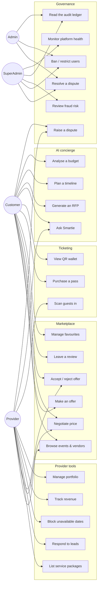
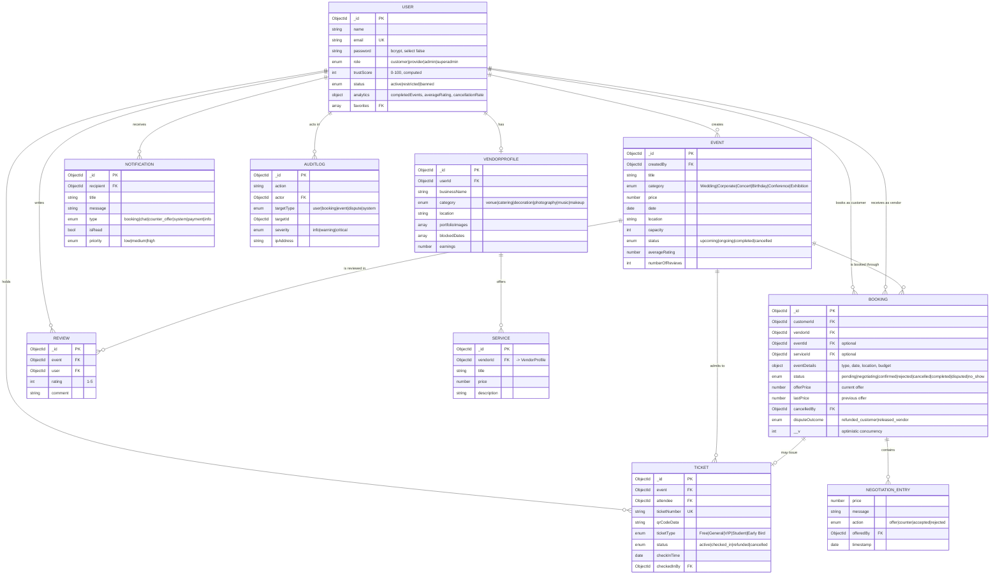
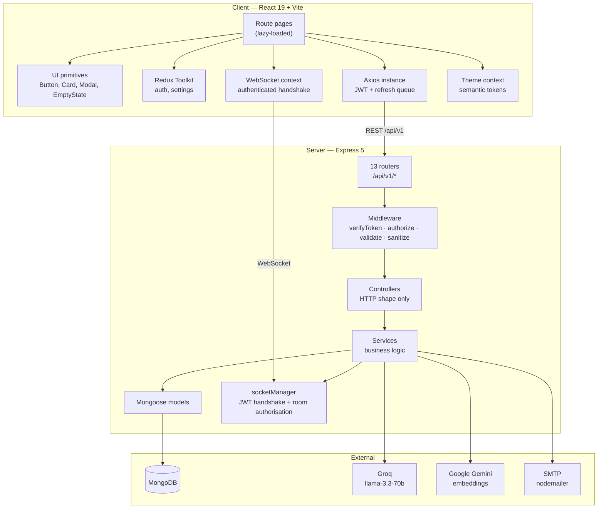
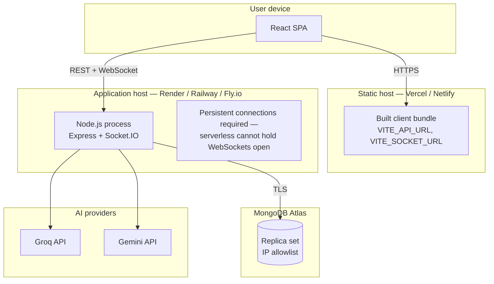
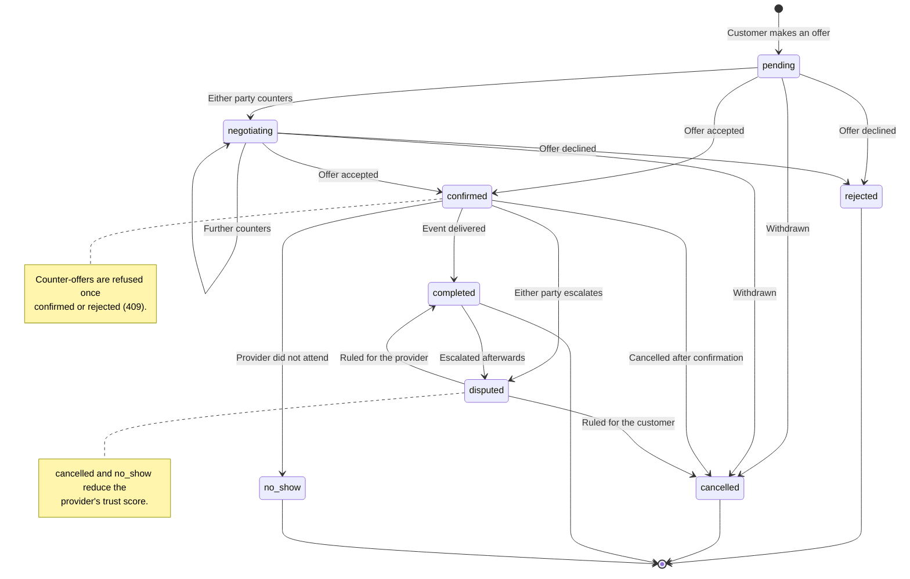
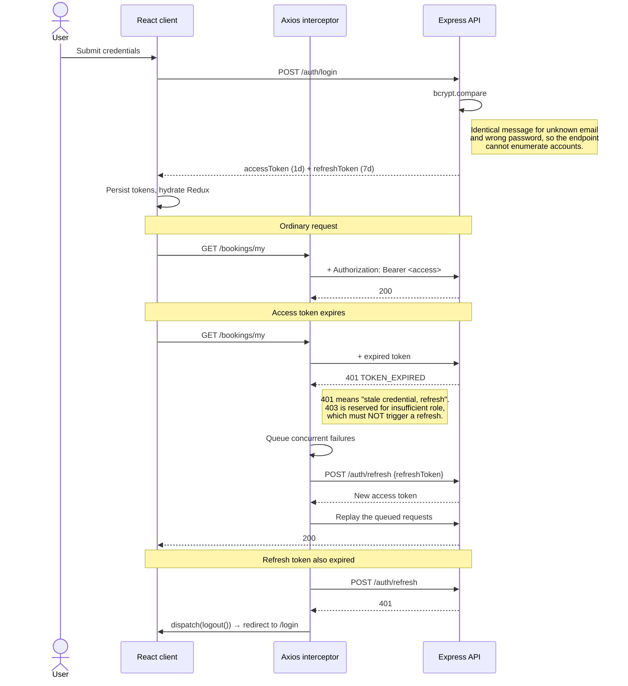
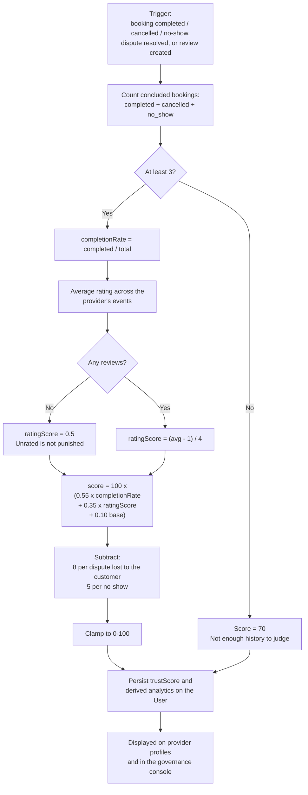
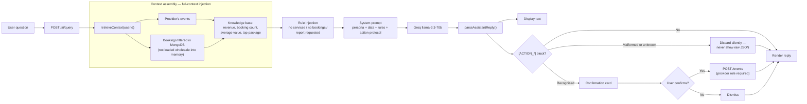

# SmartEvents — System Diagrams

Mermaid diagrams, rendered natively by GitHub. For the report, open this file
on GitHub and export each diagram, or paste the source into
[mermaid.live](https://mermaid.live) to download SVG/PNG.

Every diagram below is derived from the actual code, not from an earlier plan.

---

## 1. Use case diagram



---

## 2. Entity relationship diagram



---

## 3. Sequence diagram — the negotiation lifecycle

This is the project's core contribution, so it carries the most detail.

```mermaid
sequenceDiagram
    actor C as Customer
    participant UI as React client
    participant API as Express API
    participant DB as MongoDB
    participant WS as Socket.IO
    actor P as Provider

    Note over C,P: 1 — Opening offer
    C->>UI: Enter offer of $4,000
    UI->>API: POST /bookings {eventId, offerPrice, message}
    API->>API: Zod validation + role check (customer)
    API->>DB: Look up event, resolve vendorId
    API->>DB: Check provider blockedDates
    alt Date is blocked
        API-->>UI: 409 "Provider unavailable on that date"
    else Date is free
        API->>DB: Create Booking, history[0] = {price, message, action:"offer"}
        API->>DB: Write Notification for provider
        API->>WS: emitToUser(vendorId, "notification")
        WS-->>P: Live badge, no refresh needed
        API-->>UI: 201 Created
    end

    Note over C,P: 2 — Both parties open the thread
    C->>WS: connect (JWT in handshake)
    WS->>WS: Verify token, derive user room
    C->>WS: join-negotiation(bookingId)
    WS->>DB: Confirm caller is customer or vendor on this booking
    WS-->>C: Joined (silently ignored if not a party)
    P->>WS: join-negotiation(bookingId)

    Note over C,P: 3 — Counter-offer
    P->>API: POST /bookings/:id/negotiate {price: 4500, message}
    API->>API: Reject if already confirmed or rejected (409)
    API->>DB: lastPrice = offerPrice; offerPrice = 4500
    API->>DB: Append history[1] {action:"counter"}
    alt Both parties countered simultaneously
        DB-->>API: VersionError (optimistic concurrency)
        API-->>P: 409 "Modified by someone else — please refresh"
    else Write succeeded
        API->>WS: emitToRoom(bookingId, "offer-countered")
        WS-->>C: Toast + live price update
        API-->>P: 200 with the updated booking
    end

    Note over C,P: 4 — Settlement
    C->>API: PUT /bookings/:id/accept
    API->>DB: status = "confirmed"
    API->>WS: emitToRoom(bookingId, "offer-accepted")
    WS-->>P: Live confirmation
    API->>DB: Notification for both parties

    Note over C,P: 5 — After the event
    C->>API: POST /bookings/:id/dispute {reason}
    API->>API: Party check + status must be confirmed/completed
    API->>DB: status = "disputed"
    Note right of API: An administrator then rules on the outcome,<br/>which recalculates the provider's trust score.
```

---

## 4. Component / architecture diagram



---

## 5. Deployment diagram



---

## 6. Booking state machine



---

## 7. Authentication and token refresh



---

## 8. Trust score calculation



---

## 9. AI concierge request flow


