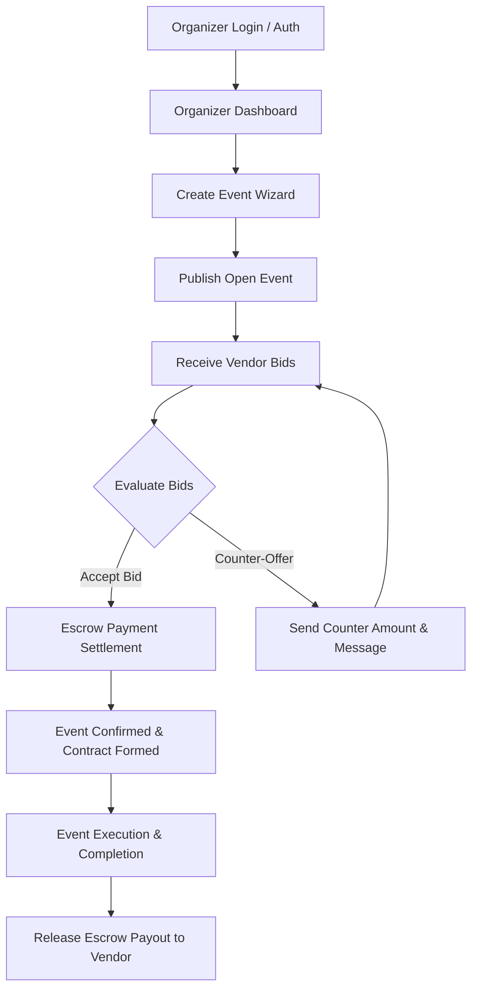

# SOFTWARE FUNCTIONAL SPECIFICATION (SFS)
## Persona Focus: Event Manager / Organizer Module
## Document Version: 1.0.0
## Application: EventFlow / SmartEvents Platform

---

## 1. PURPOSE & MODULE SCOPE

This Software Functional Specification (SFS) defines the detailed functional behavior, user interface interactions, data inputs/outputs, and business logic for the **Event Manager / Organizer Persona** within the EventFlow platform.

---

## 2. ORGANIZER WORKFLOW OVERVIEW

---

## 3. DETAILED FUNCTIONAL SPECIFICATIONS

### 3.1 Module 1: Event Creation Wizard (`/organizer/events/create`)

#### Inputs:
- **Title**: String (Required, 5–100 chars).
- **Category**: Dropdown (`Corporate`, `Wedding`, `Birthday`, `Concert`, `Conference`, `Private Party`).
- **Date & Time**: DateTime Picker (Required, must be future date).
- **Location**: String (Address / Venue City).
- **Guest Count**: Number (Min 10, Max 50,000).
- **Budget Range**:
  - `minBudget`: Number (Required).
  - `maxBudget`: Number (Required, `maxBudget >= minBudget`).
  - `currency`: Default `USD`.
- **Services Needed**: Multi-select checkboxes (`Catering`, `Photography`, `Venue`, `Decoration`, `Sound & Stage`, `Security`).
- **Image Attachments**: Image URLs / Uploads.
- **Bidding Deadline**: Date Picker (Default: 7 days prior to event date).

#### System Behavior:
1. Validates inputs on client & server.
2. Creates event document with `status: 'open'` and `bidsCount: 0`.
3. Triggers real-time notification to registered vendors in matching service categories.
4. Redirects organizer to `/organizer/events/:id`.

---

### 3.2 Module 2: Bid Inbox & Counter-Offer Negotiation (`/organizer/events/:id`)

#### User Interactions:
- **View Proposals**: Displays list of vendor bids sorted by price, rating, or submission date. Each card shows vendor avatar, rating (e.g., 4.9 ★), bid amount, cover letter, deliverables checklist, and timeline.
- **Action Buttons**:
  - `Accept Bid`: Launches Stripe Escrow Payment Modal. Upon payment, status becomes `confirmed`.
  - `Counter-Offer`: Opens Counter-Offer Modal.
  - `Reject`: Sets bid status to `rejected`.

#### Counter-Offer Modal Behavior:
- **Input**:
  - `counterAmount`: Number (Required, must be > 0).
  - `message`: Textarea (Optional custom negotiation note).
- **Execution**:
  - Appends counter-offer object `{ from: 'organizer', amount, message, createdAt }` to bid `counterOffers` array.
  - Updates bid `amount` to `counterAmount` and `status` to `'counter_offered'`.
  - Sends instant socket notification & email alert to the vendor.

---

### 3.3 Module 3: Escrow Payment Settlement (`/payments/create-intent`)

#### Business Logic:
1. When Organizer accepts a bid, system generates Stripe Payment Intent for `bid.amount`.
2. Upon successful charge confirmation:
   - Payment record created: `status: 'paid'`, `paidAt: Date.now()`.
   - Event status updated to `'confirmed'`.
   - Vendor receives automated confirmation & contract document.
3. Post-event completion: Organizer clicks `"Release Funds"`, changing payment status to `'released'` and executing payout to vendor bank account.

---

### 3.4 Module 4: Organizer Dashboard Analytics (`/organizer/dashboard`)

#### Key Performance Metrics Displayed:
- **Total Events Posted**: Count of all events created by organizer.
- **Active Bids Received**: Sum of pending proposals across all open events.
- **Confirmed Contracts**: Events currently scheduled with accepted vendors.
- **Total Escrow Budget**: Cumulative dollar volume committed in active events.

---

## 4. INTERFACE & UI/UX SPECIFICATIONS (Adyen Design System)

- **Palette**: Background `#00112C` Deep Navy, Surface `#051838`, Accent `#0ABF53` Adyen Green.
- **Buttons**: Full-pill `rounded-full` (`btn-adyen-primary` & `btn-adyen-outline`).
- **Cards**: `adyen-card` with `border: 1px solid rgba(255,255,255,0.12)`.
- **Feedback**: Toast notifications (green success `#0ABF53`, red error `#EF4444`).
